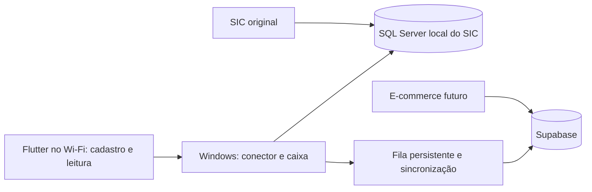

# Lineboard

Gerenciamento Windows integrado ao banco local do SIC, com Flutter Android/iOS
para cadastro, etiquetas e leitura remota do caixa, e sincronização com Supabase.
Cada peça física possui um código interno Code 128 exclusivo. O celular envia
leituras ao carrinho; a confirmação e a baixa acontecem no desktop.

**Estado em 31/10/2026:** desktop React/Mantine integrado ao conector SIC em
um único executável, `desktop/bin/Lineboard.exe`. Ele abre o `SICNET` local por
padrão; `desktop/scripts/start.ps1 -Lab` usa o mesmo executável com
`LINEBOARD_LAB`. Uma importação controlada levou os 57 produtos e seus recebimentos
da cópia `LINEBOARD_LAB` para a base demonstrativa `SICNET`, com backup COPY_ONLY
antes da gravação. A ponte Supabase foi ativada para esta instalação; o
acionamento fiscal continua dependente de homologação própria.

Instruções completas e limites em [desktop/README.md](desktop/README.md).

```powershell
# Na raiz, nesta máquina (LINEBOARD_LAB já preparado):
.\desktop\scripts\build.ps1
.\desktop\scripts\start.ps1

# O modo padrao usa o SICNET; para laboratorio use -Lab.

# Em outro PC, uma unica vez: pede o token sem exibi-lo, configura o usuario
# do Windows e importa todos os registros atuais do Supabase.
.\desktop\scripts\configure-cloud.ps1

# Nova cópia isolada e testes SQL Server reais:
.\desktop\scripts\test.ps1

cd mobile
flutter run --dart-define=LINEBOARD_MODE=cloud --dart-define-from-file=config.json
```

No modo de producao, cada cadastro e venda entra diretamente no `SICNET` local
em uma transacao atomica; a importacao inicial dos produtos nao e repetida para
as operacoes novas.



## Executar o fluxo Supabase anterior (modo cloud)

Requisitos: Flutter 3.47.1 / Dart 3.13.1 (versões usadas neste projeto), Android
SDK 36 e Java 17. Para iOS: macOS, Xcode e assinatura Apple; alvo iOS 15+.
O Flutter usado aqui solicita NDK `28.2.13676358`.

Se o novo Android CLI no Windows mostrar `Package ndk not found` durante a
instalação automática, instale a versão antes de compilar:

```powershell
& "$env:ANDROID_HOME\cmdline-tools\latest\bin\android.exe" --sdk $env:ANDROID_HOME sdk install ndk/28.2.13676358
```

```powershell
cd mobile
flutter pub get
Copy-Item config.example.json config.json
# Preencha a URL e a chave publishable/pública no config.json.
flutter run --dart-define=LINEBOARD_MODE=cloud --dart-define-from-file=config.json
```

Sem configuração, o app abre uma tela explicando a conexão pendente, sem catálogo
de demonstração ou operações falsas. `config.json` é ignorado pelo Git. A chave
`service_role` fica apenas nas funções do Supabase, nunca no Flutter.

## Preparar Supabase

1. Crie um projeto dedicado. Execute `supabase login`,
   `supabase link --project-ref SEU_PROJECT_REF` e `supabase db push` na raiz.
   Alternativamente, execute a migration de `supabase/migrations` no editor SQL.
2. Desative cadastro público em Authentication. Configure a URL de redirecionamento
   `io.lineboard.mobile://login-callback` na lista permitida.
3. O app aceita o código ou o link de login aberto no próprio celular. No plano
   Free com provedor de e-mail padrão, mantenha os templates padrão: o Supabase
   recusa personalização. Os templates de `supabase/templates` podem ser usados
   depois de configurar SMTP próprio. O provedor padrão restringe envio aos
   membros da equipe do projeto; SMTP para os demais usuários segue pendente.
4. Convide o primeiro administrador no painel Authentication > Users e execute
   `docs/bootstrap.sql`, substituindo o e-mail e o nome da loja. Repita apenas para
   novas empresas. O app não oferece criação pública de empresas.
5. Publique `supabase functions deploy invite-member commerce sic-sync sic-command-ack --use-api`
   e aplique também a migration `202610310001_sic_command_bridge.sql`.
   As chaves internas padrão do Supabase
   são disponibilizadas pelo runtime (`SUPABASE_PUBLISHABLE_KEYS` e
   `SUPABASE_SECRET_KEYS`); nenhum segredo precisa ir para o app. Runtimes locais
   antigos que usam `SUPABASE_ANON_KEY`/`SUPABASE_SERVICE_ROLE_KEY` também funcionam.
6. Preencha `mobile/config.json` com a URL e a chave pública do projeto. Entre com
   o administrador e convide operadores no ícone de equipe.

As funções têm `verify_jwt=false` intencionalmente: `invite-member` valida o JWT
com `auth.getUser()` e depois a permissão no banco; `commerce` valida uma
credencial própria por empresa; `sic-command-ack` valida a credencial de
integração do desktop. Todas recusam chamadas sem autenticação válida.

## Fluxo operacional no mobile/Supabase

- **Cadastrar produto**: nome, categoria, marca, modelo, custo, preço, cor/medida
  por variante, controle por quantidade ou por unidade, quantidade inicial, foto e
  observações. Em uma loja vinculada ao SIC, o comando vai para `sic_commands`;
  o desktop gera os códigos e devolve as etiquetas após a confirmação local.
- **Etiqueta**: abra um código após o cadastro ou escaneie uma etiqueta existente.
  Compartilhe a imagem PNG pelo Android/iOS para o fluxo de impressão da loja.
- **Editar ficha**: na identificação online, atualize nome, categoria, marca,
  modelo e observações. Códigos, variantes e saldos são preservados.
- **Registrar saída**: escaneie os produtos vendidos, confira quantidades e confirme
  a venda física. Um comprovante só aparece após a confirmação do desktop pela fila.
- **Retomar operação**: em resposta incerta, a solicitação fica em SQLite, separada
  por usuário/empresa. Reenvios usam o mesmo identificador. Reabrir o app e entrar
  com o mesmo usuário permite recuperar o resultado.
- **Identificar offline**: fichas previamente sincronizadas podem ser abertas por
  código sem rede, com aviso de possível desatualização. Não incluem saldo nem
  imagens offline. Cadastro e saída não são confirmados offline; não há fila que
  venda automaticamente depois de reconectar.

Admin e operador podem cadastrar e vender. Só admin convida funcionários e
gerencia credenciais de integração. RLS, FKs compostas por organização e RPCs
com verificação de acesso isolam as lojas. Usuários podem pertencer a mais de uma
loja. Logout apaga fichas locais; operações ainda não resolvidas permanecem
reservadas ao mesmo usuário para recuperação após novo login.

## Integração futura

Contrato, autenticação, exemplos e limites em [docs/commerce-api.md](docs/commerce-api.md).
O desktop local está em `desktop/`; a ponte SIC → Supabase usa a migration
`202610280001_sic_bridge.sql` e a função `sic-sync`, publicadas em 31/10/2026.
O e-commerce terá backend/frontend próprios futuramente e está fora desta
etapa. O retorno de pedidos remotos para o SIC ainda não foi implementado.

## Verificar e compilar

```powershell
# Raiz: executa a migration real num PostgreSQL WASM e testa transações/RLS.
npm ci
npm test
npm run test:postgres

# Funções TypeScript
npx -y deno check --config supabase/functions/deno.json supabase/functions/commerce/index.ts supabase/functions/invite-member/index.ts
npx -y deno test --config supabase/functions/deno.json supabase/functions/_shared/environment_test.ts

cd mobile
flutter analyze
flutter test
flutter build apk --debug --dart-define-from-file=config.json
# Em um Mac:
flutter build ios --no-codesign --dart-define-from-file=config.json
```

A suíte SQL usa PGlite com stubs apenas de `auth`/`storage`; executa as tabelas,
políticas e funções da migration sem reimplementar as regras em JavaScript.
O teste `test:postgres` cria um cluster temporário PostgreSQL nativo e disputa a
última unidade em conexões separadas, além de reenviar a mesma venda em paralelo.
O cluster é encerrado e removido ao finalizar. Não substitui validação de
Auth/SMTP, Storage e dispositivos num Supabase real.
Antes de uso operacional, execute [docs/acceptance.md](docs/acceptance.md) em
Android e iPhone com um projeto configurado. O APK debug sem chaves serve para
verificar a compilação e só mostra a tela de configuração.

Android release ainda usa a chave debug do scaffold; configure um keystore
próprio antes de distribuir pela loja. iOS precisa de assinatura e testes em
Mac/iPhone. Este projeto não inclui pagamento, reservas de checkout, estorno,
reposições, inventário ou faturamento no fluxo Supabase anterior. O novo Windows
oferece ajustes de estoque somente em laboratório, sem processamento de pagamento
ou emissão fiscal.

Referências usadas: [funções PostgreSQL no Supabase](https://supabase.com/docs/guides/database/functions),
[Supabase Flutter](https://pub.dev/packages/supabase_flutter),
[leitura por câmera](https://pub.dev/packages/mobile_scanner) e
[compartilhamento nativo](https://pub.dev/packages/share_plus).
